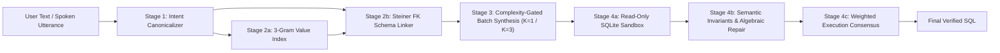

# Argus-SQL — Markdown Architecture Document (MAD)

> [!IMPORTANT]
> **Clean-Room Independence Mandate**: Every file, commit, and architectural specification in `argus_sql` represents independent personal scholarly work built exclusively on public academic literature, public benchmarks (`BIRD-SQL`, `Spider`), and the Python standard library.

---

## 1. Methodology & Architectural Paradigm

- **Methodology**: `DomainFirst` + **Contract-First Hexagonal Architecture** (Functional Core, Imperative Shell) combined with **Pipes & Filters**.
- **Language & Runtime**: Python `>= 3.11` zero-dependency core (`sqlite3`, `ast`, `urllib.request`, `concurrent.futures`, `dataclasses`) + LaTeX (`pdflatex` + `bibtex`) for reproducible manuscript generation.



---

## 2. Visual Tree (`visual_tree`)

```text
argus_sql/
├── .github/workflows/
│   ├── ci.yml                        # Zero-secret hermetic clean-room & matrix CI
│   └── live_bird_eval.yml            # Manual personal cloud BIRD workflow_dispatch
├── .githooks/
│   ├── pre-commit                    # Clean-room leak, AST & unittest gate
│   └── commit-msg                    # Commit message clean-room leak gate
├── config/
│   └── personal_env.example          # Personal-machine-only .env template
├── scripts/
│   ├── run_personal_eval.sh          # Personal machine live eval + bundle signer
│   └── ingest_personal_feedback.sh   # Offline bundle quarantine scan & ingester
├── AGENTS.md                         # Contributor & AI clean-room invariants
├── CLEAN_ROOM_POLICY.md              # Independent research & IP isolation policy
├── README.md                         # Quickstart, ablations & split CI/CD guide
├── pyproject.toml                    # Package metadata & CLI entrypoints
├── .copilot_compliance.json          # Dynamic modularity & comment density policy
├── docs/
│   ├── ARCHITECTURE_MAD.md           # This Master Architecture Document
│   └── CICD_SPLIT_WORKFLOW.md        # Split-environment CI/CD & feedback guide
├── paper/
│   ├── main.tex                      # Camera-ready 2-column research manuscript
│   ├── references.bib                # Public peer-reviewed & arXiv bibliography
│   ├── main.pdf                      # Compiled camera-ready PDF manuscript
│   └── tables/
│       ├── diagnostic_main.tex       # Auto-generated B0..B3 vs Argus-SQL table
│       └── diagnostic_ablation.tex   # Auto-generated leave-one-out ablation table
├── results/
│   ├── diagnostic_benchmark.json     # Full task-level EX & R-VES telemetry
│   └── feedback/                     # SHA-256-verified sanitized feedback bundles
└── src/argus_sql/
    ├── guardrails/                   # Clean-room IP/secret scanner & AST verifier
    ├── contracts/                    # Pure domain dataclasses & range/composite-PK DDL
    ├── linking/                      # Voice canon., 3-gram/code index & FK/junction graph
    ├── sandbox/                      # Read-only authorizer-locked SQLite sandbox
    ├── verification/                 # 10 dialect/relational invariants, repair & vote
    ├── adapters/                     # Vertex/OpenAI batch HTTPS & DDL synthesizer
    ├── pipelines/                    # B0, B1, B2, B3 baselines & Argus-SQL hybrid
    └── evaluation/                   # BIRD EX/R-VES, MIN..MAX/CSV hydration & triage
```

---

## 3. Typed Dependency Mapping (`typed_dependency_mapping`)

Dependencies point strictly inward toward `argus_sql.contracts`:

| Package | Allowed Internal Imports | External I/O Permitted? | Primary Contract Types |
| :--- | :--- | :--- | :--- |
| `guardrails` | Self-contained (`guardrails.*`) | Local repo read-only scan | `LeakRule`, `LeakFinding`, `GuardrailAuditReport` |
| `contracts` | None (foundational leaf) | **No** (Pure Core) | `DatabaseSchema`, `NLQueryTask`, `IntentFrame`, `SQLCandidate` |
| `linking` | `contracts` | Optional RO `SELECT DISTINCT` at index init | `ValueIndexEntry`, `ColumnScore`, `SchemaLinkerConfig` |
| `sandbox` | `contracts` | **Yes** (`?mode=ro` SQLite URI only) | `SandboxPolicy`, `ExecutionOutcome` |
| `verification` | `contracts` | **No** (Pure Core) | `InvariantIssue`, `VerifiedCandidate`, `ConsensusCluster` |
| `adapters` | `contracts` | **Yes** (`https://` / `127.0.0.1` batch POST) | `BatchLLMPort`, `LLMCompletionRequest`, `LLMCompletionResponse` |
| `pipelines` | `contracts`, `linking`, `sandbox`, `verification`, `adapters` | Delegated via Ports | `NL2SQLPipeline`, `ArgusAblationConfig`, `PipelinePrediction` |
| `evaluation` | `contracts`, `linking`, `sandbox`, `pipelines`, `adapters` | Confined JSON/LaTeX/MD output | `TaskEvalRecord`, `BenchmarkSuiteReport`, `FeedbackBundle` |

---

## 4. Implementation & Extension DAG (`implementation_dag`)

1. **Step 1 — Hermetic Clean-Room & Core Contracts (Zero Network)**:
   - Validate `guardrails` and `contracts` in isolation:
     `PYTHONPATH=src python3 -m unittest discover -s src/argus_sql/guardrails -p "*_test.py"`
     `PYTHONPATH=src python3 -m unittest discover -s src/argus_sql/contracts -p "*_test.py"`
2. **Step 2 — Linking, Sandbox & Semantic Invariant Core**:
   - Validate `linking`, `sandbox`, and `verification` with local temporary SQLite fixtures:
     `PYTHONPATH=src python3 -m unittest discover -s src -p "*_test.py"`
3. **Step 3 — Comparative Pipelines & Diagnostic Ablation Export**:
   - Regenerate `paper/tables/*.tex` and `results/diagnostic_benchmark.json`:
     `PYTHONPATH=src python3 -m argus_sql.evaluation.cli --mode diagnostic`
4. **Step 4 — Split-Environment Personal Live Evaluation & Offline Feedback Ingestion**:
   - Keep the authoring environment credential-free; execute `./scripts/run_personal_eval.sh` on a personal machine with local runtime credentials, and ingest the SHA-256-verified `FeedbackBundle` offline via `./scripts/ingest_personal_feedback.sh`.

> [!WARNING]
> **Halt-Check Architectural Directive**: *Should architectural drift or runtime failure require core interface alterations against MAD documents, halt explicitly requesting manual MAD updates before patching local improvisations silently.*
