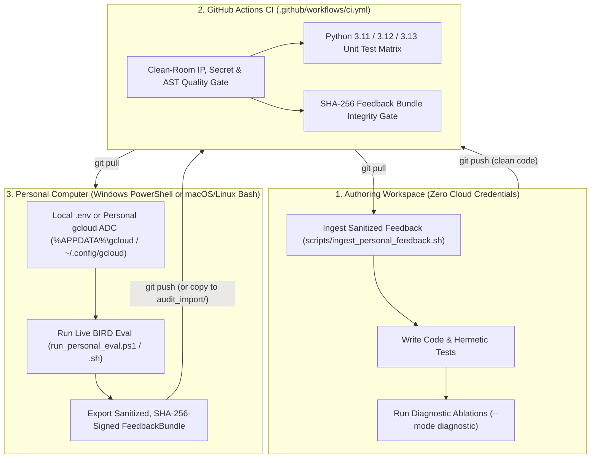

# Split-Environment Clean-Room CI/CD & Bidirectional Feedback Guide

> [!IMPORTANT]
> **Zero-Credential Authoring Principle**: Never log into personal `gcloud` accounts or store live API keys inside the authoring workspace. All code authoring, hermetic unit testing, diagnostic ablations, and failure-triage refinements happen **100% offline** here, while live LLM benchmark runs execute strictly on your **personal computer** (or personal GitHub Actions secrets).

---

## 1. End-to-End Architecture



---

## 2. Step-by-Step Workflow

### Phase A — Author & Verify Code Here (Credential-Free Workspace)

1. Run the clean-room, AST quality, and hermetic unit test gates locally (zero network calls, zero `gcloud` login):
   ```bash
   PYTHONPATH=src python3 -m argus_sql.guardrails.cli --bootstrap-git --verify-all
   PYTHONPATH=src python3 -m unittest discover -s src -p "*_test.py" -v
   PYTHONPATH=src python3 -m argus_sql.evaluation.cli --mode diagnostic
   ```
2. Commit and push to your personal GitHub repository:
   ```bash
   git add -A
   git commit -m "feat(pipeline): refine schema linking and feedback pipeline"
   git push origin main
   ```
   GitHub Actions (`.github/workflows/ci.yml`) automatically verifies clean-room isolation, AST invariants, and unit tests across `ubuntu-latest` (`3.11`–`3.13`) and `windows-latest` (`3.12`) with zero secrets required.

---

### Phase B — Test Against Live Models on Your Personal Computer (Windows + Antigravity IDE or POSIX)

On your **personal Windows PC (inside Antigravity IDE or PowerShell)** or macOS/Linux laptop (where your personal `gcloud` ADC or personal API key lives):

1. **Windows + Antigravity IDE (Recommended)** — Clone the repository and open the folder directly in **Antigravity IDE** on Windows:
   - Antigravity IDE automatically loads [`AGENTS.md`](../AGENTS.md) and [`CLEAN_ROOM_POLICY.md`](../CLEAN_ROOM_POLICY.md), while `.gitignore` and the clean-room scanner automatically ignore local IDE workspace folders (`.antigravity/`, `.gemini/`, `.vscode/`).
   - In Antigravity IDE's integrated PowerShell terminal, unpack `MINIDEV.zip` and configure your gitignored `.env` locally:
     ```powershell
     git pull origin main
     New-Item -ItemType Directory -Force -Path data\bird\mini_dev | Out-Null
     Expand-Archive -LiteralPath "$HOME\Downloads\MINIDEV.zip" -DestinationPath data\bird\mini_dev -Force

     Copy-Item config\personal_env.example .env
     notepad .env
     # Defaults to GOOGLE_CLOUD_LOCATION=global and ARGUS_LLM_MODEL=gemini-3.7-flash.
     # If using Vertex AI on Windows, authenticate locally (writes %APPDATA%\gcloud\application_default_credentials.json):
     gcloud auth application-default login
     ```
   - Run a fast 20-query smoke slice first, then the comparative `bird_mini_dev` split (`-RecomputeArgus` evicts stale `Argus-SQL` JSONL checkpoint rows in `results/live_runs/` while reusing cached `B0..B3` baselines):
     ```powershell
     # Fast 20-query smoke check on Windows PowerShell:
     .\scripts\run_personal_eval.ps1 -Limit 20 -OnlyArgus -RecomputeArgus

     # Stratified comparative evaluation (B0..B3 + fresh Argus-SQL on Clean + Voice-BIRD):
     .\scripts\run_personal_eval.ps1 -RecomputeArgus
     ```
   - **Copy-Paste Prompt for Your Windows Antigravity Agent** (after setting `.env` / `gcloud` locally):
     ```text
     Read docs/CICD_SPLIT_WORKFLOW.md and AGENTS.md. Verify that data/bird/mini_dev is unpacked and local .env / gcloud ADC is ready on GOOGLE_CLOUD_LOCATION=global using gemini-3.7-flash (never print secret values). Run .\scripts\run_personal_eval.ps1 -RecomputeArgus (or -FreshCheckpoint if prompts changed for all systems), confirm zero clean-room leaks and valid SHA-256 signatures, and commit/push ONLY results/feedback/bird_feedback_bundle.json, results/feedback/triage_report.md, and paper/tables/bird_live.tex to main.
     ```

2. **Antigravity Remote Linux VM / macOS / POSIX Bash** — Native Linux commands (often faster for downloading the 1.3 GB BIRD SQLite archive directly over VM cloud bandwidth):
   ```bash
   # 1. Pull latest clean-room code and configure your local gitignored .env
   #    (defaults to GOOGLE_CLOUD_LOCATION=global and ARGUS_LLM_MODEL=gemini-3.7-flash):
   git pull origin main
   cp config/personal_env.example .env

   # 2. On a headless remote Linux VM, use --no-launch-browser for personal ADC:
   gcloud auth application-default login --no-launch-browser

   # 3. Run stratified comparative slice (--recompute-argus refreshes Argus-SQL against cached B0..B3):
   ./scripts/run_personal_eval.sh --recompute-argus
   # Or run full 500-query split across 10-minute VM windows (auto-resumes via results/live_runs/):
   ARGUS_LIMIT=0 ./scripts/run_personal_eval.sh --recompute-argus
   ```
   - **Copy-Paste Prompt for Your Antigravity Remote Linux VM Agent**:
     ```text
     Read docs/CICD_SPLIT_WORKFLOW.md and AGENTS.md. Pull latest origin/main and verify that data/bird/mini_dev (mini_dev_sqlite.json, dev_tables.json, and dev_databases/*.sqlite) is staged and local .env / gcloud ADC is ready on GOOGLE_CLOUD_LOCATION=global using gemini-3.7-flash (never print secret values). Run `./scripts/run_personal_eval.sh --recompute-argus` to re-evaluate updated Argus-SQL against the stratified 11-DB checkpoint (or `--fresh-checkpoint` to recompute all 5 systems), confirm zero clean-room leaks and valid SHA-256 signatures, and commit/push ONLY results/feedback/bird_feedback_bundle.json, results/feedback/triage_report.md, and paper/tables/bird_live.tex to main.
     ```

3. `run_personal_eval.ps1` / `run_personal_eval.sh` automatically:
   - Scrubs Windows (`C:\Users\...`, `C:\\Users\\...`, `file:///C:/Users/...`) and POSIX workstation paths plus credential patterns from SQL error summaries,
   - Signs `results/feedback/bird_feedback_bundle.json` with a canonical LF-normalized SHA-256 digest,
   - Renders `results/feedback/triage_report.md` and `paper/tables/bird_live.tex`, and
   - Runs `argus_sql.guardrails.cli --scan-path results/feedback` **before** you commit so zero personal machine paths or secrets can ever leave your computer.
4. Push the sanitized feedback back to GitHub (or copy `bird_feedback_bundle.json` into `audit_import/`):
   ```powershell
   git add results/feedback/bird_feedback_bundle.json results/feedback/triage_report.md paper/tables/bird_live.tex
   git commit -m "chore(eval): publish sanitized BIRD feedback bundle"
   git push origin main
   ```

---

### Phase C — Ingest Feedback & Iterate Here ("Vice Versa")

Back in this credential-free authoring workspace:

1. Pull from GitHub (or place `bird_feedback_bundle.json` inside the quarantined `audit_import/` folder) and run:
   ```bash
   ./scripts/ingest_personal_feedback.sh
   # (Or `.\scripts\ingest_personal_feedback.ps1` on Windows PowerShell)
   ```
2. The ingestion pipeline fails closed on any leak or SHA-256 mismatch, updates `paper/tables/bird_live.tex`, and writes a ranked root-cause engineering report to `results/feedback/triage_report.md` containing:
   - **Per-database EX% rankings** isolating the hardest schemas,
   - **Failure clusters** (`MISSING_SCHEMA_TABLE`, `MISSING_OR_AMBIGUOUS_COLUMN`, `EMPTY_PREDICTED_RESULT`, `INVARIANT_FLAGGED`, etc.) mapped directly to concrete `src/argus_sql/` modules,
   - **Clean-to-Voice spoken regression pairs** for `intent_canonicalizer.py`, and
   - **Sanitized broken SQL traces** ready to turn into deterministic unit tests offline!
